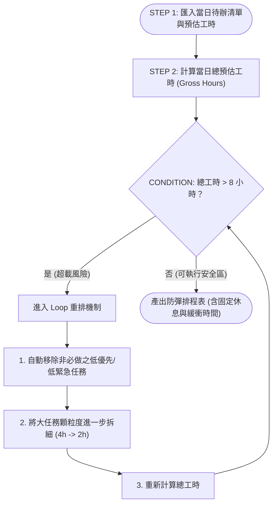

# AI 自動排程演算法 (AI Scheduling Graph & Loop)

## 1. 概念與系統背景

傳統的時間管理往往依賴人類脆弱的自制力與過度樂觀的直覺，導致排程永遠超載。
**AI 自動排程演算法** 提出了一種**基於圖論與迴圈控制 (Graph / Loop Architecture)** 的防彈工時動態編譯模型。它將「保護心智頻寬」作為硬性約束條件，透過自動化演算法取代人類主觀的排程糾結。

---

## 2. 演算法邏輯流程圖 (Algorithm Flowchart)

---

## 3. 三大步驟與動態迴圈剖析

1. **STEP 1: 任務輸入與顆粒度標註**
   * 使用者或系統匯入當日待辦事項，每項任務必須強制填寫「預估工時（顆粒度以 15~60 分鐘為宜）」。
2. **STEP 2: 總工時彙總 (Gross Hours Calculation)**
   * 加總所有任務預估時間。
3. **CONDITION: 生理臨界條件判定**
   * **硬性閾值**：總工時是否超過 **8 小時**？
   * 若超標，演算法拒絕輸出排程，強制觸發 **Loop 重排機制**：
     * **動作 A（剪枝 Pruning）**：結合 [[艾森豪矩陣 (Eisenhower Matrix)]]，自動將第 III、IV 象限之任務移出今日清單。
     * **動作 B（切細 Splitting）**：將超過 2 小時的大任務進一步降維拆解（例如將「寫期末專案」拆為「完成引言 500 字」），避免 [[完美主義癱瘓 (Perfectionism Paralysis)]]。
     * **動作 C（回圈迭代）**：重複運算直到總工時安全落入 $\le 8$ 小時（大學生高強度深度專注建議落於 4~5 小時最佳區間）。
4. **OUTPUT: 產出防彈日程表**
   * 輸出融合 [[番茄工作法 (Pomodoro Technique)]]（25/5 節奏）與 [[時間塊排程 (Time Blocking)]]（預留緩衝區間）的可執行時間表。

---

## 4. 關聯頁面 (Cross-References)
* 理論機制：[[雙曲貼現 (Hyperbolic Discounting)]]、[[完美主義癱瘓 (Perfectionism Paralysis)]]
* 核心方法：[[1-3-5 待辦法則 (1-3-5 Rule)]]、[[艾森豪矩陣 (Eisenhower Matrix)]]、[[番茄工作法 (Pomodoro Technique)]]
* 實戰劇本：[[大學生期末考多科集中爆炸排程 (Finals Week Crisis Management)]]
